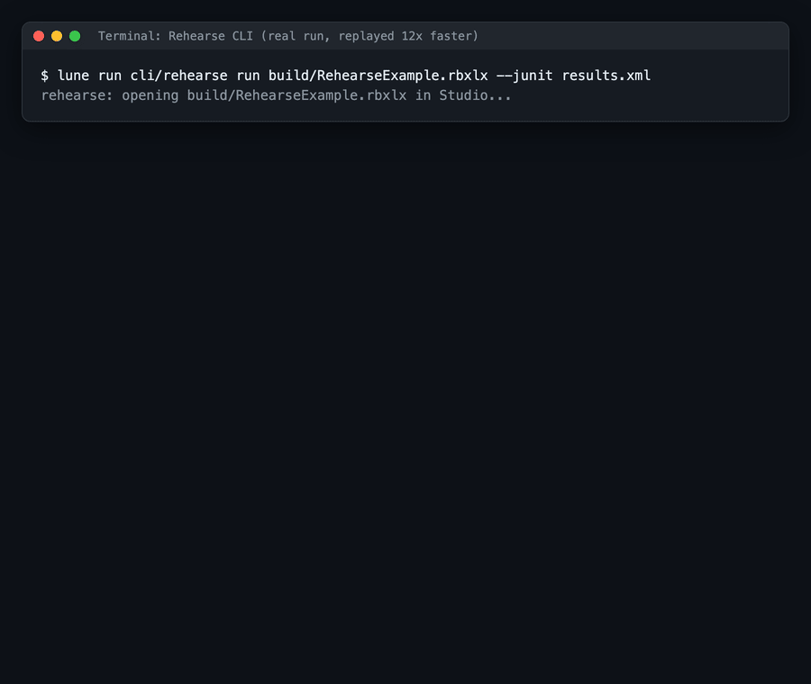
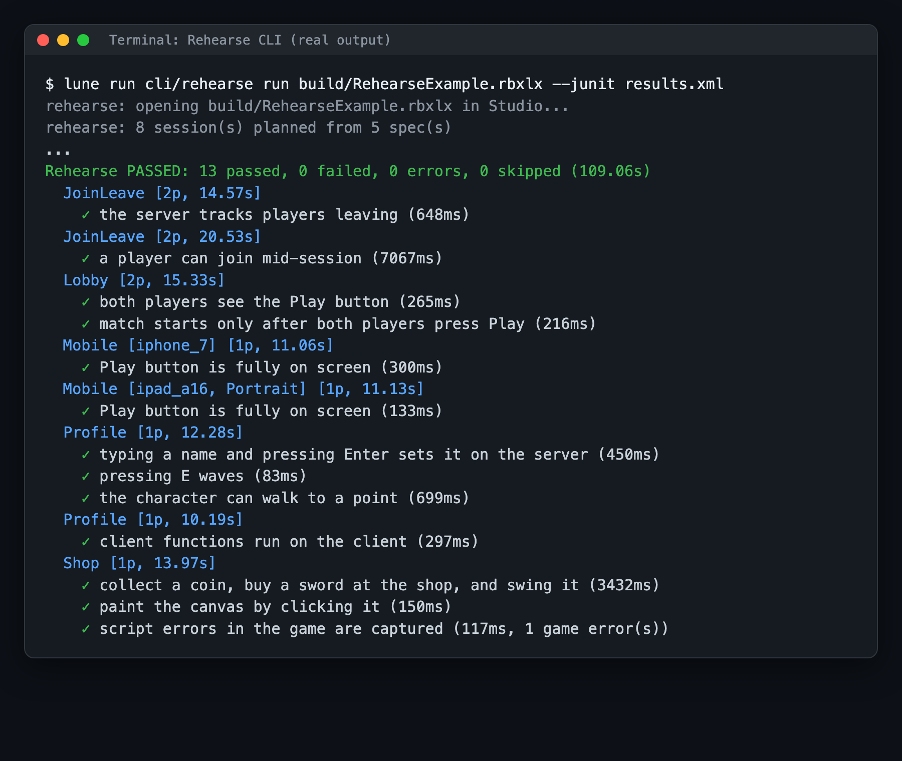
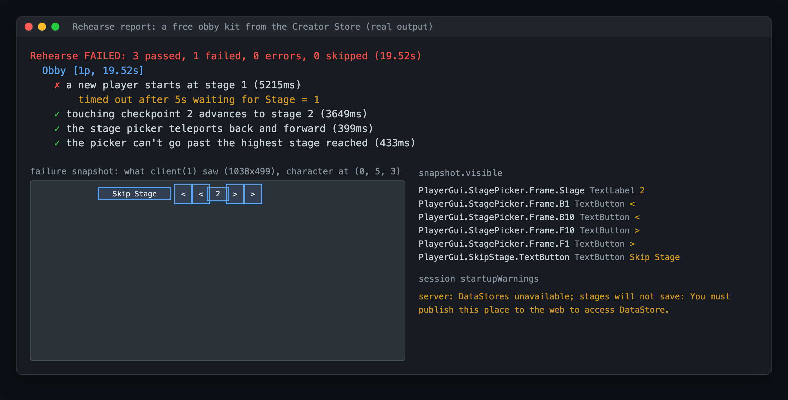

<!--
DRAFT for DevForum > Community Resources. Not posted. The repo owner posts it.

Before posting:
  [ ] Make github.com/alexander-michaelides/rehearse public (the links below 404 while it's private)
  [ ] Merge the open PRs and cut the release the "Download" link points to
  [ ] Record the demo clip (see the note at the top of the post) and upload the images in launch/media/
  [ ] Decide on Creator Store: publish the plugin there, or remove that line
  [ ] Reread the claims below against the version you release
-->

# Rehearse: end-to-end and multiplayer tests for your game, using Roblox's new testing APIs

When `StudioTestService` and `VirtualInput` came out ([announcement](https://devforum.roblox.com/t/4116257), [VirtualInput and Device Simulator](https://devforum.roblox.com/t/4657854)), a lot of replies asked the same thing: how do I turn this into an actual test suite? Something you can rerun after every change, with more than one player, that clicks the real UI and tells you what broke ([example](https://devforum.roblox.com/t/4474643/17)).

Rehearse is my attempt at that missing layer. You write a short spec. Rehearse starts a real Studio test session with up to 8 clients, drives each one with real input, checks state on the server and the clients, and gives you a pass/fail report. You can run it from a toolbar button, from a terminal, or have an AI agent run it through the Studio MCP.

<!-- DEMO CLIP: screen-record a run of the example place (Studio + the two client windows clicking
     the Play button and the shop), about 15–20 s, then convert it to a GIF. Put it here. -->



## What a spec looks like

```lua
-- ServerStorage/RehearseSpecs/Lobby
return function(s)
	s.players(2)

	s.test("match starts only after both players press Play", function(t)
		local p1, p2 = t.client(1), t.client(2)

		p1:click("PlayerGui.Menu.Frame.PlayButton")
		t.waitFor(function() return p1.player:GetAttribute("Ready") end, 5, "player 1 to be ready")
		t.expect(workspace:GetAttribute("MatchStarted")).toBe(false)

		p2:click("PlayerGui.Menu.Frame.PlayButton")
		t.waitFor(function() return workspace:GetAttribute("MatchStarted") end, 5, "the match to start")
		t.expect(p1:waitFor("PlayerGui.Menu.Enabled", false)).toBe(false)
	end)
end
```

Every client action waits for its target first, so specs don't need `wait(2)` sprinkled everywhere.

## What it can do (v0.2)

- **Multiplayer:** 1–8 clients per session. Players can leave mid-test, and `addPlayers` (experimental, see below) adds them mid-test.
- **Real input:**
  - `click` on GUI buttons, `fill` text boxes, `key` presses
  - `clickWorld` on parts (for tools that read the mouse), `prompt` for ProximityPrompts
  - `equip`/`activate` tools, `moveTo` for walking a character
- **Devices:** run a spec on several simulated devices (`s.devices({ "iphone_7", "ipad_a16" })`) and check that UI is fully on screen.
- **Script errors are part of the result.** Errors and warnings from server and client scripts during each test are recorded, and `s.failOnErrors()` makes them fail the test.
- **Failures show what the player saw.** A failed test records each client's visible UI (paths and text), position, health and equipped tool. You can often see the problem ("the shop never opened") without reproducing it.
- **Reports:** readable text, JSON and JUnit XML. A CLI exits non-zero on failure, so it can gate a self-hosted CI job or a pre-publish check.
- **Agent-friendly:** an AI agent with the Studio MCP can write a spec, run it, read the JSON, fix the game and rerun. There's an [AGENTS.md](https://github.com/alexander-michaelides/rehearse/blob/main/AGENTS.md) and a Studio skill for this.



## A real example: testing a free obby kit

To see whether it holds up outside my own example game, I took a popular free obby kit from the Creator Store (checkpoints, saving, stage picker) and wrote four tests for it. The first run failed everything. The report pointed at the cause straight away: the kit calls `GetDataStore` at the top of its stage script, which throws in an unpublished place, so `leaderstats` is never created and every other script errors after it. The kit also only works with R6 avatars.

After fixing those, 3 of 4 tests pass. The fourth is still red, and I think correctly. A new player's character briefly passes through checkpoint 2 while being teleported on spawn, so they start on stage 2. Here's the report with the failure snapshot drawn out:



## How it works

Studio loads plugins into every DataModel of a test session, so one plugin plays three roles. In Edit it plans and launches sessions. On the test server it runs the spec. On each client it performs input with `VirtualInput` and answers questions about client state. Nothing is added to your saved place. The objects it needs exist only inside the test session.

It also works around some rough edges people have reported with these APIs:
- Sessions that return nothing when started too early.
- Clients that never join, which Rehearse replaces.
- Sessions that never finish, which the CLI cleans up and retries.

## Limitations (please read)

- **Early software.** Tested on macOS with Studio 0.748. Windows support is written but **untested**.
- **Speed:** each test session takes about 8–12 s to start (mostly clients joining). Tests in a spec share a session unless you mark them `isolated`.
- **`addPlayers` can crash Studio's test server** (the [known AddPlayers issue](https://devforum.roblox.com/t/4691976)). After a crash, Studio may show a dialog that blocks new launches until you dismiss it. That example test is skipped by default.
- **No touch input:** `VirtualInput` doesn't support it. Mobile tests can check layout, but input is mouse and keyboard.
- **Held keys:** test clients run in background windows, where held keys don't register. Use `moveTo` to walk, and prompts fall back to the ProximityPrompt API.
- **CI:** the CLI needs Studio installed and signed in, so it works on your machine or a self-hosted runner, not on GitHub-hosted runners.
- **One run at a time per Studio instance.**

## Get it

- **Source and docs:** https://github.com/alexander-michaelides/rehearse
- **Download:** `Rehearse.rbxm` from [Releases](https://github.com/alexander-michaelides/rehearse/releases). Put it in your Plugins folder and restart Studio.
- **Creator Store:** _(link if published)_
- **Price:** free, MIT-licensed. I may later sell a convenience UI (a test explorer, a click recorder) on the Creator Store. The runner, the spec API, the CLI and the reports will stay free.

## Roadmap

- A test explorer widget: run one test, rerun failures, see results inline.
- A recorder that turns your clicks into a spec.
- Hints for common errors (for example the DataStore-in-unpublished-place error).
- Windows verification and a CI guide.

Bug reports and ideas are very welcome in [GitHub Issues](https://github.com/alexander-michaelides/rehearse/issues). If you try it on your own game, I'd especially like to hear what you couldn't test with it.
